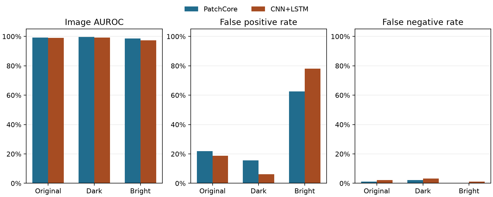

# 光照變化下的工業表面瑕疵檢測

## 研究問題

本實驗比較精簡版 PatchCore 與 CNN＋LSTM 在合成亮度變化下的皮革瑕疵偵測表現。偏暗時，CNN＋LSTM 比 PatchCore 少誤報 3 張正常圖，多漏檢 1 張瑕疵圖。偏亮時，兩種方法的誤報都明顯增加，CNN＋LSTM 的誤報率更高。

## 資料與方法

使用 MVTec AD 的 `leather` 類別。以固定種子 42 將 245 張正常訓練圖分為 196 張訓練圖與 49 張驗證圖。官方測試集共 124 張，包含 32 張正常圖和 92 張瑕疵圖。兩個模型使用同一批影像，同一原圖的亮度版本都留在原圖所屬的切分中。原圖先轉為 RGB，縮放至 224 × 224，再以 ImageNet 的均值和標準差正規化。用凍結的 ResNet-18 取出 `layer2` 和 `layer3` 的特徵，將兩層對齊並串接為 28 × 28 個位置、每位置 384 維的特徵圖。[資料來源](https://www.mvtec.com/research-teaching/datasets/mvtec-ad) · [切分清單](results/split.csv) · [亮度樣圖](results/brightness_preview.png)

- **精簡版 PatchCore。** 用原始亮度的正常圖建立特徵記憶庫，先抽取 10,000 個候選特徵，再用貪婪最遠點抽樣保留 1,024 個。計算各區塊到最近正常特徵的歐氏距離，取影像中最大的距離。選用此方法是為了延續期中提案的基準。此實作採用 ResNet-18 和簡化評分。[PatchCore 原始論文](https://openaccess.thecvf.com/content/CVPR2022/papers/Roth_Towards_Total_Recall_in_Industrial_Anomaly_Detection_CVPR_2022_paper.pdf)
- **CNN＋LSTM。** 把同一張正常圖做成 70%、80%、90%、100% 的亮度序列。對同一位置，輸入前三步的 CNN 特徵，預測第四步，以均方誤差訓練單層 LSTM 和線性輸出層。隱藏維度為 64，使用 Adam，學習率 0.001，訓練 10 輪。第 10 輪正常驗證誤差最低，MSE 從第 1 輪的 0.007071 降至 0.002221。影像分數取所有位置中最大的預測誤差。選用 LSTM 是為了測試由暗到亮的特徵預測能否用來偵測異常。[訓練紀錄](full-results/training_history.csv)

測試時對同一批圖套用原始（×1.00）、偏暗（×0.75）、偏亮（×1.25）三種條件。對 LSTM 而言，每個條件下的圖成為序列的第四步，再由它生成前三步。兩個模型各用原始光照下 49 張正常驗證圖的異常分數第 95 百分位設定門檻，測試期間固定。分數大於門檻即判為疑似有瑕疵。Image AUROC 衡量兩類影像分數的排序能力，誤報率和漏檢率則衡量固定門檻的實際判斷。[驗證分數](full-results/validation_scores.csv)

## 實驗結果

| 測試光照 | 模型 | Image AUROC | 正常圖誤報 | 瑕疵圖漏檢 |
|---|---|---:|---:|---:|
| 原始 | PatchCore | 0.9915 | 7/32（21.9%） | 1/92（1.1%） |
| 原始 | CNN＋LSTM | 0.9891 | 6/32（18.8%） | 2/92（2.2%） |
| 偏暗 | PatchCore | 0.9956 | 5/32（15.6%） | 2/92（2.2%） |
| 偏暗 | CNN＋LSTM | 0.9925 | 2/32（6.3%） | 3/92（3.3%） |
| 偏亮 | PatchCore | 0.9868 | 20/32（62.5%） | 0/92（0%） |
| 偏亮 | CNN＋LSTM | 0.9735 | 25/32（78.1%） | 1/92（1.1%） |

[完整比較表](full-results/metrics.csv) · [逐圖分數](full-results/image_scores.csv)

## 分析與改進

- **PatchCore 在三種條件下的 Image AUROC 都較高，漏檢也較少。** 它以正常區塊為參照，評分較容易解釋。記憶庫只包含原始光照下的特徵，亮度改變後，正常區塊也可能離參照特徵更遠。偏亮時仍有 0.9868 的 AUROC，但有 20 張正常圖超過門檻，顯示排序表現好仍可能遇到門檻失準。
- **CNN＋LSTM 在偏暗條件下減少誤報，但多漏檢一張瑕疵圖。** 它能用多個亮度版本建立預測，預測誤差小的瑕疵仍可能被漏掉。以 `test/color/009.png` 為例，偏暗後細紅色痕跡仍可看見，LSTM 分數為 0.01183，低於其門檻 0.01465。這張圖在三種亮度下都被 LSTM 漏掉。
- **同一張正常圖的分數會隨亮度變動。** `test/good/013.png` 在偏亮時被兩組誤報。CNN＋LSTM 的分數從原始條件的 0.01910 升到 0.02412，PatchCore 則從 3.78481 升到 3.82170。兩者各自的門檻為 0.01465 和 3.13806，因此該正常圖在原始條件下也已被誤報。[錯誤案例圖](full-results/error_examples.png)

後續可先在正常訓練資料加入獨立的亮度增強，並在留出的正常影像上檢查三種亮度的分數分布後重新校準門檻，再用保留的測試集評估。若要驗證順序本身的作用，可加做順序打亂的對照，使用相同的特徵與預測目標。本次結果涵蓋單一皮革類別與人工亮度變換。期中研究可沿用此流程，再驗證實際光照條件和像素級定位。

[重跑說明與檔案索引](README.md)
